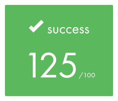
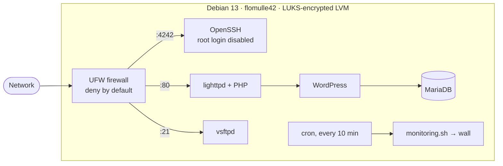

<div align="center">

# Born2beRoot · 42 Paris

**Building and hardening a Linux server from scratch: encrypted storage, least-privilege access, firewalling, monitoring and a production-style web stack.**




</div>

---

## Results

| | |
|---|---|
| **Final grade** | **125 / 100**, the maximum possible (mandatory part + every bonus) |
| **Peer evaluations** | 3 / 3 passed at 125% |
| **Format** | Solo project, about 50 hours |
| **School** | 42 Paris, Common Core curriculum (completed) |

What my evaluators wrote (translated from French):

> *"Serious and meticulous work. The VM works: we tested everything and everything checks out."*

> *"Great work, knows the material inside out. Very clean."*

> *"Project fully completed. Thanks for all the explanations!"*

---

## Context: the 42 Common Core

42 is a software engineering school with no teachers, lectures or classes. Students learn by building projects, and every project is graded by other students through live code reviews and defenses.

The **Common Core** is 42's main curriculum. Students start it after passing the Piscine, a month-long selection bootcamp, and it typically takes 18 to 24 months. It is a series of projects grouped into ranks, and each rank must be completed before the next one opens. The projects start with C and Unix fundamentals, then cover algorithms, concurrency, system administration, networking, graphics and C++, and finish with a full-stack web application built as a team.

Born2beRoot is one of the first Common Core projects and the introduction to system administration. Later projects build on it, such as NetPractice (TCP/IP networking) and Inception (containerized infrastructure with Docker).

**I have completed the entire Common Core.**

---

## What I built

A Debian 13 server running in VirtualBox with no graphical interface. Every requirement had to hold up during a live defense, where evaluators inspected the machine, changed it on the spot (renamed the host, created users and groups) and asked me to explain each choice.



---

## Skills demonstrated

| Area | What I did | Why it matters in production |
|---|---|---|
| **Virtualization** | Sized and configured a VM (4 GB RAM, 3 vCPUs), set up NAT port forwarding, used snapshots to keep the graded disk state intact | Same model as cloud instances, machine images and snapshots |
| **Storage & encryption** | LUKS full-disk encryption with LVM split into 7 logical volumes | Protects data at rest. Isolating `/var/log` and `/tmp` stops one runaway process from filling the root filesystem |
| **Access control** | Users and groups, strict `sudo` policy that logs every command's input and output | Least privilege and a full audit trail for incident response |
| **Authentication policy** | Password complexity and aging enforced through PAM (`pam_pwquality`) and `login.defs` | Enforces an organisation's password policy at the OS level |
| **Network security** | SSH on a non-default port with root login disabled, UFW firewall that blocks everything not explicitly allowed | Shrinks the attack surface |
| **Mandatory access control** | AppArmor kept enabled and enforcing | Defense in depth beyond Unix permissions |
| **Scripting & scheduling** | Bash monitoring script run by `cron` and broadcast to every terminal | Basic observability: the same metrics a monitoring agent collects |
| **Web stack** | WordPress on lighttpd + MariaDB + PHP (FastCGI) | Deploying and securing a database-backed web app |
| **Service integration** | vsftpd FTP server added and justified as an extra service | Choosing a service, integrating it and opening only the ports it needs |
| **Communication** | Defended every design decision live in front of 3 different peers | Explaining technical trade-offs clearly to colleagues |

---

## Technical overview

### Disk layout (bonus)

Only `/boot` stays unencrypted. Everything else sits in an encrypted LUKS container managed by LVM:

```
sda
├─ sda1                /boot        unencrypted
└─ sda5
   └─ sda5_crypt                    LUKS encrypted
      └─ LVMGroup                   LVM volume group
         ├─ root       /
         ├─ swap       [SWAP]
         ├─ home       /home
         ├─ var        /var
         ├─ srv        /srv
         ├─ tmp        /tmp
         └─ var-log    /var/log
```

### Security hardening

| Component | Configuration |
|---|---|
| **SSH** | Port `4242`, `PermitRootLogin no` |
| **Firewall** | UFW enabled at boot. Default deny incoming. Open ports: `4242` (SSH), `80` (HTTP), `21` (FTP) |
| **Password aging** | Expires every 30 days, minimum 2 days between changes, warning 7 days before expiry |
| **Password strength** | At least 10 characters with an uppercase letter, a lowercase letter and a digit. No more than 3 identical characters in a row, must not contain the username, must differ from the old password by at least 7 characters (root is exempt from this last rule only). The policy applies to root as well |
| **sudo** | 3 attempts maximum, custom error message, TTY required, restricted `secure_path`, full input/output logging to `/var/log/sudo/` |
| **Users** | Personal account in the `sudo` and `user42` groups. Every password changed after the policy was applied, root included |
| **AppArmor** | Active and enforcing |

### Monitoring script

`monitoring.sh` runs from root's crontab every 10 minutes and uses `wall` to broadcast a system report to every logged-in terminal. It never prints an error. Example output (illustrative values):

```
#Architecture: Linux flomulle42 6.12.x-amd64 #1 SMP Debian x86_64 GNU/Linux
#CPU physical : 1
#vCPU : 3
#Memory Usage: 312/3915MB (7.97%)
#Disk Usage: 1.9/30Gb (7%)
#CPU load: 2.1%
#Last boot: 2025-12-05 17:20
#LVM use: yes
#Connections TCP : 1 ESTABLISHED
#User log: 1
#Network: IP 10.0.2.15 (08:00:27:d4:1b:81)
#Sudo : 42 cmd
```

| Metric | Source |
|---|---|
| Architecture / kernel | `uname -a` |
| Physical CPUs / vCPUs | `/proc/cpuinfo` (`physical id` / `processor`) |
| RAM and disk usage | `free -m`, `df` |
| CPU load | `vmstat` / `top` |
| Last boot | `who -b` |
| LVM active | `lsblk` (looks for `lvm` devices) |
| TCP connections / users | `ss -ta`, `users` |
| IPv4 / MAC address | `hostname -I`, `ip link` |
| sudo command count | `journalctl _COMM=sudo` |

To stop the broadcasts without touching the script, stop the `cron` service or disable its crontab entry.

### Bonus services

- **WordPress on lighttpd, MariaDB and PHP.** A full web stack without Apache or NGINX. lighttpd hands PHP to PHP-CGI over FastCGI, and MariaDB runs with a dedicated database and a least-privilege user for WordPress.
- **vsftpd (my free-choice service).** A lightweight FTP server with a strong security track record. I chose it because it gives site administrators a simple way to upload themes, plugins and media to the WordPress site without a shell account on the server.

---

## How this can be reused

None of this is specific to a school exercise. The same setup applies directly to real infrastructure:

1. **Hardening baseline for any Debian or Ubuntu server.** The SSH, firewall, sudo and PAM configuration can be applied unchanged to a VPS, a cloud instance or a Raspberry Pi.
2. **Encrypted LVM template.** The partition scheme works for any machine holding sensitive data. LVM also makes it possible to resize or snapshot volumes later without reinstalling.
3. **Zero-dependency health check.** `monitoring.sh` runs on any Linux host. Replace `wall` with a webhook (Slack, Discord) or a log file to plug it into existing alerting.
4. **Lightweight self-hosting.** lighttpd + MariaDB + PHP runs comfortably on small hardware, which makes it a good fit for low-traffic sites and homelabs.
5. **Starting point for Infrastructure as Code.** Every step below maps directly to an Ansible task or a cloud-init directive, so the server can become reproducible and version-controlled.

<details>
<summary><b>Step-by-step rebuild guide</b></summary>

<br>

**1. Install**

Create a VirtualBox VM and install Debian (latest stable) without a desktop environment. Use manual partitioning: a `/boot` partition, then an encrypted volume holding an LVM group with the logical volumes shown above.

**2. Base packages, user and hostname** (as root)

```bash
apt update && apt install -y sudo ufw openssh-server libpam-pwquality
groupadd user42
usermod -aG sudo,user42 <login>
hostnamectl set-hostname <login>42
```

**3. SSH** in `/etc/ssh/sshd_config`

```
Port 4242
PermitRootLogin no
```

```bash
systemctl restart ssh
```

**4. Firewall**

```bash
ufw default deny incoming
ufw default allow outgoing
ufw allow 4242/tcp
ufw enable
```

**5. Password policy**

`/etc/login.defs`:

```
PASS_MAX_DAYS   30
PASS_MIN_DAYS   2
PASS_WARN_AGE   7
```

`/etc/pam.d/common-password`:

```
password requisite pam_pwquality.so retry=3 minlen=10 ucredit=-1 lcredit=-1 dcredit=-1 maxrepeat=3 reject_username difok=7 enforce_for_root
```

`login.defs` only applies to accounts created afterwards, so existing accounts need `chage`. Then change every password, root included:

```bash
chage -M 30 -m 2 -W 7 <login>
chage -M 30 -m 2 -W 7 root
```

**6. sudo** with `visudo -f /etc/sudoers.d/sudo_config` (create `/var/log/sudo` first)

```
Defaults  passwd_tries=3
Defaults  badpass_message="Wrong password, try again."
Defaults  logfile="/var/log/sudo/sudo.log"
Defaults  log_input, log_output
Defaults  iolog_dir="/var/log/sudo"
Defaults  requiretty
Defaults  secure_path="/usr/local/sbin:/usr/local/bin:/usr/sbin:/usr/bin:/sbin:/bin:/snap/bin"
```

**7. Monitoring.** Add this line to root's crontab (`crontab -e`):

```
*/10 * * * * bash /usr/local/bin/monitoring.sh
```

**8. Bonus: WordPress**

```bash
apt install -y lighttpd mariadb-server php-cgi php-mysql
lighty-enable-mod fastcgi fastcgi-php && systemctl reload lighttpd
mysql_secure_installation
# create the WordPress database and a dedicated user, then unpack WordPress into /var/www/html
ufw allow 80/tcp
```

**9. Bonus: vsftpd**

```bash
apt install -y vsftpd
# /etc/vsftpd.conf: anonymous_enable=NO, local_enable=YES, write_enable=YES, chroot_local_user=YES
ufw allow 21/tcp
```

**10. Verify**

```bash
lsblk                       # encrypted LVM layout
sudo ufw status numbered    # only the expected ports are open
ss -tunlp                   # listening services
sudo aa-status              # AppArmor enforcing
chage -l <login>            # password aging
getent group sudo user42    # group membership
```

</details>

---

## About this repository

Under 42's rules, the graded submission is a single `signature.txt` containing the SHA-1 hash of the VM's virtual disk. The VM itself is never published. This repository documents the project, what it taught me and how to reproduce it.

## Contact

- **[LinkedIn](https://www.linkedin.com/in/flmu/)**
- **[Email](mailto:fl.mu@outlook.com)**
- **42 intra:** `flomulle`

